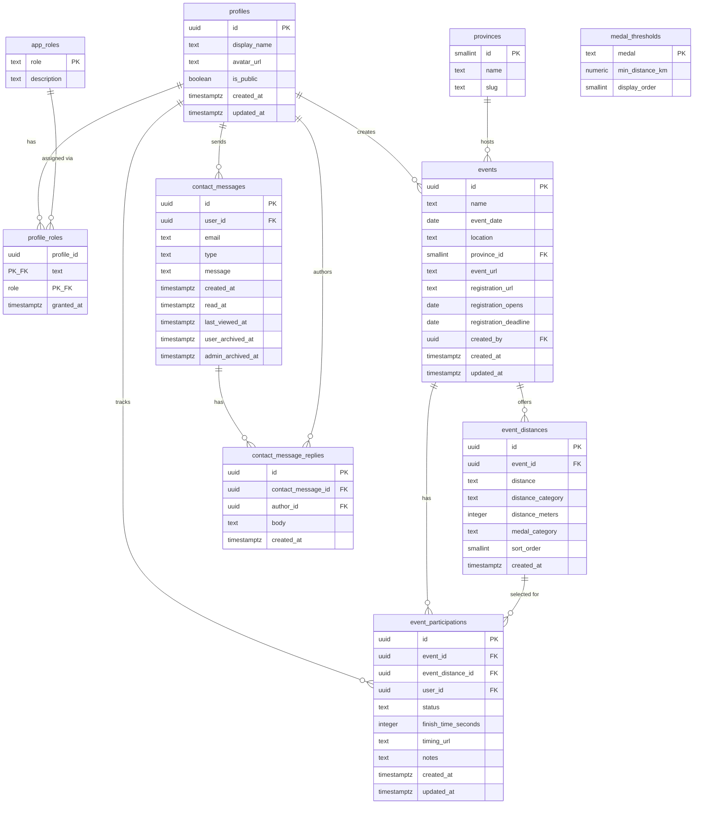

# Twaalf Provincies — Database Schema
**twaalfprovincies.run**

---

## Notes

- `medal_thresholds` / `get_medal(distance_km)` is legacy schema and is not used by the current event-distance flow
- `profile_roles` is a join table with a composite primary key `(profile_id, role)`
- Before a profile is deleted (including the cascade from deleting an Auth user), `private.transfer_events_before_profile_deletion()` transfers its events to the recipient in `private.event_ownership_settings`. Event distances and other users' participations remain intact; the deleted user's own participations still cascade away.
- The recipient is configured separately per environment by a database administrator. The private settings table has RLS enabled and no client access. Its single row contains `singleton = true` and `fallback_profile_id`, referencing an existing profile. Account identifiers belong in private ops documentation, not migrations. Configure a different recipient before deleting the fallback account. Deleting an event creator without a configured recipient fails atomically; deleting a user without events does not require configuration.
- Run `pnpm test:db` for the isolated PGlite database regression tests covering account deletion, ownership transfer, preservation of other users' data, and client access restrictions. These tests do not connect to Supabase.
- `event_participations` has a unique constraint on `(event_id, user_id)` — one record per user per event
- `event_participations.event_distance_id` stores the specific distance selected for an event participation
- `finish_time_seconds` is an integer (seconds) — format to `h:mm:ss` in the frontend
- `status` enum values: `interested`, `signed_up`, `completed`, `dns`, `dnf`, `cancelled`
- `distance_category` enum values: `10k`, `half`, `marathon`
- `event_distance` enum values: `10k`, `15k`, `10_miles`, `half_marathon`, `30k`, `marathon`
- `event_distances.distance_meters` stores the exact length in meters; the event-write RPCs and `enforce_event_distance_category` trigger derive it from `event_distance`
- `event_distances.distance_category` is retained for existing reads and constrained to match the generated `medal_category`
- `get_event_cancellation_signals()` returns cancellation counts only for events the authenticated user already has an `interested` or `signed_up` participation for; it does not expose other users' notes
- `contact_messages` stores authenticated user support/contact requests; admins can read and mark them as read, and users can read their own message threads. `last_viewed_at` tracks when the user last opened their message overview so new replies can be highlighted. `user_archived_at` and `admin_archived_at` hide threads from the regular user and admin lists without deleting the underlying record.
  Personal message queries and view updates explicitly filter by the authenticated user's `user_id`, including for admins who can read all threads through RLS. The user-menu notification follows its destination: admins see unread, non-archived admin messages; other users see unread replies in their own non-archived threads.
- `contact_message_replies` stores in-app admin replies to contact messages. Admins can create replies; the original message owner can read replies to their own messages.
- Deleting an Auth user preserves their contact threads and replies. `private.detach_contact_messages_before_user_deletion()` clears `contact_messages.user_id` and replaces the stored email with `<verwijderde gebruiker>` before deletion. Both the sender foreign key and reply author foreign key use `ON DELETE SET NULL`; `author_id` is nullable for deleted administrators. A check constraint prevents detached messages from retaining an email address. Existing RLS keeps detached threads visible only to admins. Message/reply bodies and archive state remain unchanged; identifying information in free text and external email copies require separate review during an erasure request.
